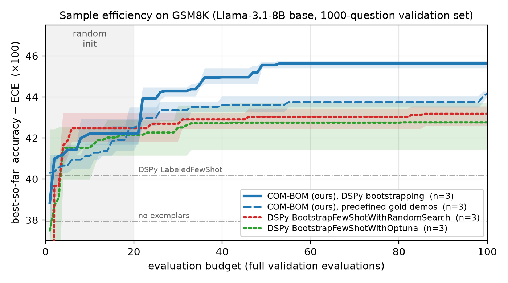

# COM-BOM [EMNLP'25]
[](https://github.com/astral-sh/uv)
<a href='https://arxiv.org/abs/2510.01178'></a>


[](LICENSE)

**COM-BOM picks the few-shot examples for your LLM prompt so that the program is both accurate and calibrated.** Instead of returning one program tuned for a single score, it returns the whole accuracy–calibration trade-off, and it finds good programs with few evaluations. It works as a drop-in optimizer for [DSPy](https://dspy.ai).

> **[COM-BOM: Bayesian Exemplar Search for Efficiently Exploring the Accuracy-Calibration Pareto Frontier](https://aclanthology.org/2025.emnlp-main.1027/)**  
> [Gaoxiang Luo](https://gaoxiangluo.github.io/), [Aryan Deshwal](https://aryandeshwal.github.io/)    
> *In Proceedings of the 2025 Conference on Empirical Methods in Natural Language Processing, 2025* 
>

[[`Paper`](https://aclanthology.org/2025.emnlp-main.1027/)] [[`DSPy integration`](integrations/dspy/)] [[`BibTeX`](#CitingCOM-BOM)]

<p align="center">
  
</p>

On GSM8K, with DSPy's defaults and the same evaluation budget for every method, COM-BOM finds programs with a better accuracy–calibration trade-off than DSPy's own exemplar optimizers, and gets there with fewer evaluations.

---
## Use COM-BOM with DSPy

### Installation

```bash
git clone https://github.com/GaoxiangLuo/COM-BOM.git
cd COM-BOM/integrations/dspy
uv sync
export PYTHONPATH=$(git rev-parse --show-toplevel):$(git rev-parse --show-toplevel)/integrations/dspy
```

The integration is its own `uv` project on current DSPy, BoTorch and GPyTorch. It reuses the `combom` package from the repository root.

### Quickstart

```python
import dspy
from dspy.datasets.gsm8k import gsm8k_metric
from dspy_combom import COMBOM, SelfConsistency

dspy.configure(lm=dspy.LM("openai/<your-model>", api_base="http://localhost:8000/v1", api_key="local"))

class Solve(dspy.Signature):
    question: str = dspy.InputField()
    reasoning: str = dspy.OutputField()
    answer: str = dspy.OutputField()

# 16 samples per question; the majority answer is the prediction, its vote share the confidence
program = SelfConsistency(Solve, n=16, temperature=0.7, field="answer")

optimizer = COMBOM(metric=gsm8k_metric, bootstrap=True, num_trials=100, num_threads=64)
best = optimizer.compile(program, trainset=trainset, valset=valset)  # lists of dspy.Example

best.pareto_programs  # the accuracy / calibration front: pick the trade-off you need
```

`bootstrap=True` builds the pool of candidate examples the same way DSPy's own few-shot optimizers do (`BootstrapFewShot`), and COM-BOM then searches over subsets of that pool. `compile` returns one program from the front; `best.pareto_programs` holds all of them, each with its validation accuracy and calibration error. The [integration README](integrations/dspy/) covers the options, base (non-chat) models and how to tune the surrogate model for a new task.

### Results on GSM8K

Llama-3.1-8B (base), DSPy defaults for every method, 100 validation evaluations each, 3 seeds, full 1319-question test set:

| optimizer | accuracy | calibration error (ECE) | accuracy − ECE |
| --- | --- | --- | --- |
| **COM-BOM** | 63.7 | **19.1** | **44.6** |
| DSPy `BootstrapFewShotWithRandomSearch` | 63.2 | 20.3 | 42.9 |
| DSPy `BootstrapFewShotWithOptuna` | 65.1 | 22.8 | 42.3 |
| no examples | 60.0 | 22.3 | 37.8 |

The DSPy optimizers select their programs by `accuracy − ECE`, the score in the last column, so this comparison favors them; COM-BOM optimizes both objectives and reports the front. Every COM-BOM seed beats every seed of either DSPy optimizer, and its programs use about half as many examples as random search's. The [full benchmark](integrations/dspy/#gsm8k-benchmark) has the protocol, hypervolume and commands to reproduce it.

### What you need

- A model you can sample from several times per question, for example served with [vLLM](https://github.com/vllm-project/vllm). Calibration is measured from how often the samples agree, so the samples must vary (temperature > 0).
- A labeled training set to build the example pool from, and a validation set to score programs on.
- Budget: every evaluation runs the program on the whole validation set with 16 samples per question.

## How it works

COM-BOM treats example selection as a search over subsets of a candidate pool. Each evaluated subset is scored on two objectives, accuracy and expected calibration error. A Gaussian process per objective models how the scores depend on which examples are included. A multi-objective acquisition function (expected hypervolume improvement), searched within a trust region, picks the next subset to try. The result is the set of programs no other evaluated program beats on both objectives. Details are in the [paper](https://aclanthology.org/2025.emnlp-main.1027/).

## Repository Structure

- **`integrations/dspy/`**: COM-BOM as a DSPy optimizer (`COMBOM`), the GSM8K benchmark against DSPy's optimizers, and tools to tune the surrogate model for a new task
- **`combom/`**: Core optimization components:
  - Trust region management
  - Gaussian process modeling with categorical kernels
  - Multi-objective acquisition function optimization
- **`train.py`**: Task-agnostic Bayesian optimization driver that loads YAML configurations
- **`test.py`**: Evaluation script for trained models and baselines
- **`configs/`**: YAML configuration templates for experiments
- **`tasks/`**: Task definitions with evaluation logic and metric specifications
- **`utils/`**: Shared utilities (random seeding, etc.)
- **`assets/`**: Figures used in this README
- **`.claude/skills/combom-gp-tuning/`**: A coding-agent skill for tuning and justifying the surrogate model on a new task

## Reproducing the Paper (MMLU-Pro)

The scripts below run the paper's experiments directly, without DSPy.

### Installation

We manage dependencies with `uv`, which recreates the Python ">=3.12" environment described in `pyproject.toml`.

```bash
uv sync
```

### vLLM Serving

Training and evaluation needs a locally-hosted LLM. The default config (`configs/mmlupro.yaml`) expects `Qwen/Qwen3-8B` to be served on `http://localhost:8000`.

```bash
# 2xA100-40GB
uv run vllm serve Qwen/Qwen3-8B --port 8000 --chat-template misc/qwen3_nonthinking.jinja --enable-prefix-caching --gpu-memory-utilization 0.75 -tp 2

# 1xA100-80GB / 1xH100-80GB
uv run vllm serve Qwen/Qwen3-8B --port 8000 --chat-template misc/qwen3_nonthinking.jinja --enable-prefix-caching --gpu-memory-utilization 0.75
```

### Training

Kick off the Bayesian optimization pipeline with your chosen configuration.

```bash
uv run python train.py --config configs/mmlupro.yaml
```

### Testing

Evaluate Pareto candidates and baselines using the same configuration.

```bash
uv run python test.py --config configs/mmlupro.yaml
```

## <a name="CitingCOM-BOM"></a>Citing COM-BOM
If you use COM-BOM in your research, find the code useful, or would like to acknowledge our work, please consider citing our paper:

```BibTeX
@inproceedings{luo-deshwal-2025-com,
    title = "COM-BOM: Bayesian Exemplar Search for Efficiently Exploring the Accuracy-Calibration Pareto Frontier",
    author = "Luo, Gaoxiang and Deshwal, Aryan",
    booktitle = "Proceedings of the 2025 Conference on Empirical Methods in Natural Language Processing",
    month = nov,
    year = "2025",
    publisher = "Association for Computational Linguistics",
    url = "https://aclanthology.org/2025.emnlp-main.1027/",
    pages = "20350--20363",
    ISBN = "979-8-89176-332-6",
}
```
